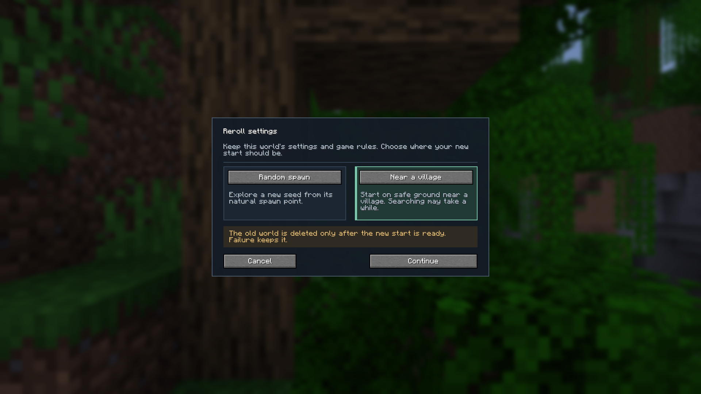
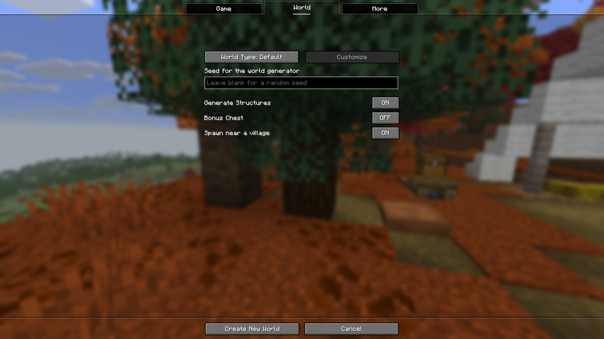
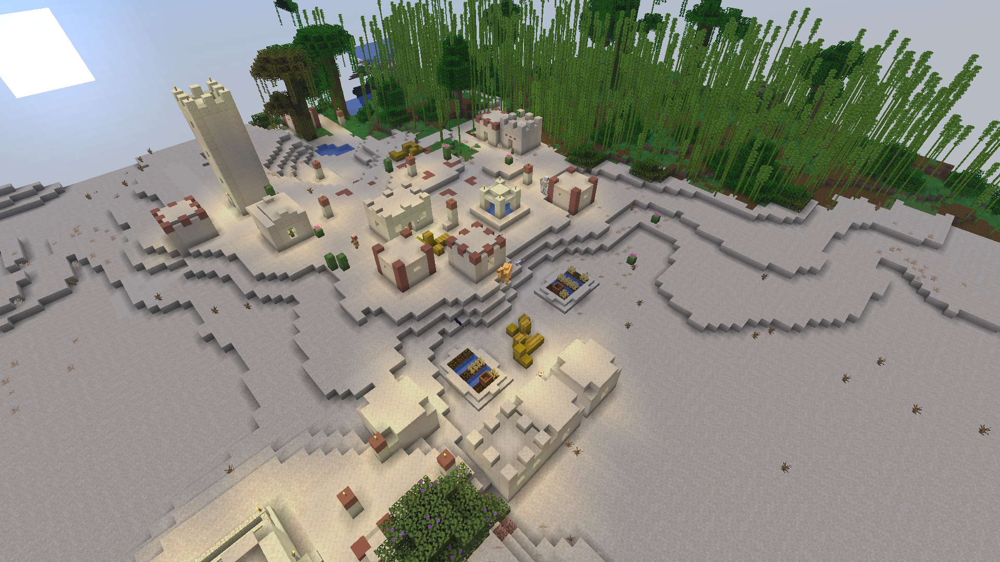
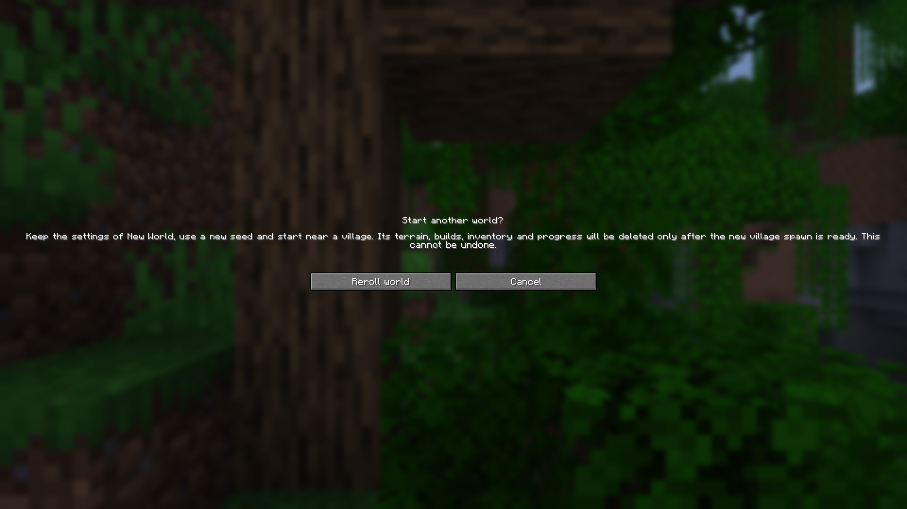

<p align="center"></p>

# World Reroll

[English](README.md) · [简体中文](README.zh-CN.md)

Try another singleplayer start without deleting a save and configuring a new world by hand. World Reroll keeps your world settings, chooses a fresh random seed, and can place your new start near a village.

**Minecraft 26.3 · Fabric · Java 25 · Singleplayer**

> **Rerolling permanently deletes the previous world's terrain, buildings, inventory and progress after the replacement is ready. Use it only for worlds you intend to discard.**

## Choose your next start



- **Random spawn** — explore the new seed from its natural spawn point.
- **Near a village** — locate an existing village and move both the player and world spawn to nearby solid ground with clear space above it. This moves the spawn after generation; it does not filter seeds for a natural village spawn.
- **Settings stay with you** — keep mode, difficulty and difficulty lock, game rules, generator, structure and bonus-chest options, enabled features, and world datapacks.
- **Readable save names** — new folders use names such as `HelloWorld-reroll-1`. Occupied names are skipped; existing saves are not renamed.

Village mode is unavailable when structure generation is disabled. Searching has a bounded range and may take time. If no village or suitable ground is found, the original world is retained. Your last selection is remembered during the current game session.

When Bonus Chest is enabled, its unopened vanilla loot table and seed move to an accessible chest within eight blocks of the final village spawn. Ordinary village chests are not moved. If vanilla could not place its original bonus chest, one is generated at the final spawn instead.

## Start a new world near a village

In **Create New World → World**, enable **Spawn near a village**, alongside **Generate Structures** and **Bonus Chest**. The option starts off for each new creation screen and requires structure generation. Your chosen seed and other creation settings stay unchanged; only the initial player/world spawn and enabled bonus chest are relocated.



This initial-creation flow never deletes another save. Failed village placement shows a notice and keeps the newly created world so you can continue playing. Selecting this option does not remember a deletion request or change an existing world's spawn on later loads.



*A real village in a replacement world, shown from a spectator overview. This is not the initial player viewpoint.*

## Install

| Requirement | Supported version |
| --- | --- |
| Minecraft Java Edition | 26.3 |
| Mod loader | Fabric Loader 0.19.5 or newer |
| Dependency | Fabric API; validated with 0.161.0+26.3 |
| Java | 25 or newer |
| Environment | Singleplayer client; unavailable on multiplayer and open-to-LAN worlds |

1. Install Fabric and a matching Fabric API version in your launcher instance.
2. Download `worldreroll-0.1.0+26.3.jar` from [GitHub Releases](https://github.com/Richasy/WorldReroll/releases).
3. Put the JAR in that instance's `mods` directory and restart Minecraft.

Lithergy is not required. Only Minecraft 26.3 has been validated; do not install this build on another Minecraft version.

## Use

1. Enter a singleplayer world and press **Esc**.
2. Click **Reroll**, next to **Save and Quit to Title**.
3. Choose a spawn preference in the panel, then click **Continue**.
4. Read the deletion notice and confirm **Reroll world**, or cancel to keep playing.



The original world is saved and closed normally. A separate replacement folder is created with a new seed and copied world datapacks. Deletion begins only after the replacement is playable for 20 consecutive client ticks. In village mode, the new position and its chunk must also reach the client first.

## What stays, and what resets?

| Kept | Reset |
| --- | --- |
| World display name, mode, difficulty and lock | Terrain and buildings |
| All saved game rules, including changes made in-game | Inventory, player state and progression |
| Generator, structure and bonus-chest options | Seed |
| Enabled features and world datapacks | Arbitrary third-party per-save state |

The new world starts fresh even when rules such as Keep Inventory are enabled. Compatibility with mods that replace world loading or depend on custom per-save data requires separate validation.

## Failure handling

- Cancelling before reroll, creation failure, or failed village placement retains the source world.
- Restarting Minecraft never resumes a pending deletion.
- Only the pinned source save is a deletion target; a unique marker and filesystem metadata verify its identity. Linked or redirected directories are rejected.
- Cleanup errors are reported in-game and logged. Once deletion has begun, an error can leave partial cleanup; the replacement remains usable.
- Failed replacements remain in the saves directory for diagnosis. A crash can leave harmless `.worldreroll-*` marker files; these never schedule deletion by themselves.

Report problems through [GitHub Issues](https://github.com/Richasy/WorldReroll/issues), including the game/mod versions, reproduction steps and relevant log excerpt.

## Development

Use JDK 25 and the checked-in wrapper:

```powershell
.\gradlew.bat build --no-daemon
.\gradlew.bat runClientGameTest --no-daemon
```

Seven unit tests cover attempt transitions and save identity/naming. Native client tests exercise the actual panel, cancellation, preserved settings and datapacks, delayed deletion, LAN gating, village placement and failure preservation. Tests use disposable saves under `build/run/clientGameTest`; manual development uses `run/client`. Never point deletion tests at personal saves. See [validation evidence](docs/VALIDATION.md).

## License and credits

[MIT](LICENSE). Inspired by the workflow of [Start Reroll](https://github.com/euruseve/StartReroll), with an independent implementation using Minecraft 26.3 APIs. Code, translations and documentation were developed with AI assistance; the icon was generated through Azure ImageGen. Documentation screenshots are captured in Minecraft, not generated images.
