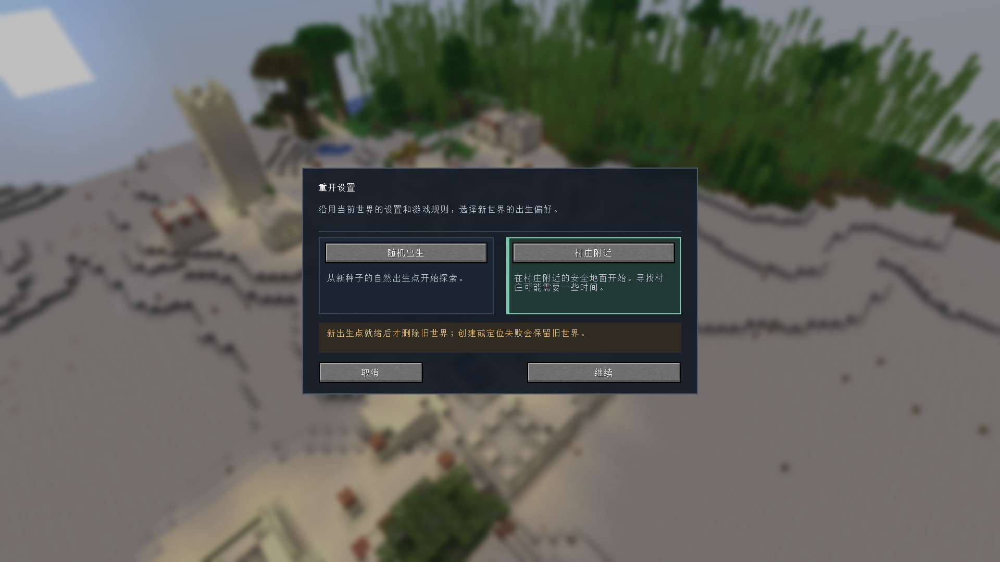
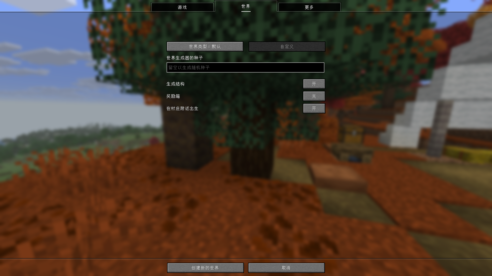
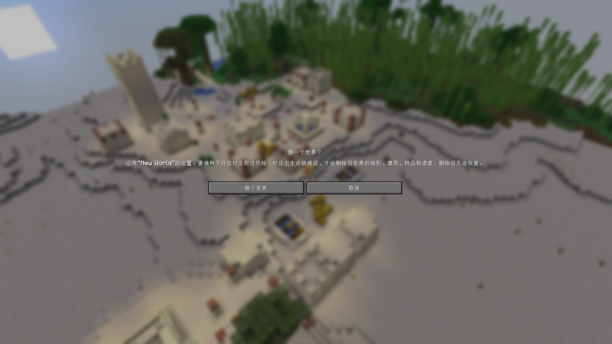

<p align="center"></p>

# World Reroll · 世界重开

[English](README.md) · [简体中文](README.zh-CN.md)

不满意这次生存开局？不用退出后删除存档、再重新填写世界参数。World Reroll 会沿用原世界设置，更换随机种子，也可以让你在村庄附近重新开始。

**Minecraft 26.3 · Fabric · Java 25 · 单人世界**

> **新世界就绪后，重开会永久删除旧世界的地形、建筑、背包和进度。请只用于你确定要舍弃的世界。**

## 选择下一个开局



- **随机出生**：从新种子的自然出生点开始探索。
- **村庄附近**：寻找已有村庄，将玩家和世界出生点移到附近有稳固地面、上方空间无遮挡的位置。这是在生成世界后调整出生点，并非筛选自然出生在村庄旁的种子。
- **保留原有设置**：沿用游戏模式、难度及难度锁定、游戏规则、世界生成器、结构和奖励箱选项、启用的功能及世界数据包。
- **简短的存档目录名**：新目录使用 `HelloWorld-reroll-1` 这样的名称，重名时跳过并递增编号，不重命名已有存档。

关闭结构生成时，“村庄附近”会显示不可选原因。寻找村庄有范围上限，可能需要等待；没有找到村庄或合适地面时，旧世界会保留。出生偏好会在本次游戏会话中记住。

开启“奖励箱”时，会把原版未打开奖励箱的战利品表和种子迁到最终村庄出生点八格以内的可打开位置，不会搬走村庄里的普通箱子。如果原版未能放置奖励箱，则在最终出生点补上一个。

## 创建新世界时就在村庄附近出生

在 **创建新的世界 → 世界** 页面中，打开 **在村庄附近出生**，它与“生成结构”“奖励箱”放在同一组选项里。每次打开新的创建界面时默认关闭，需要启用结构生成。你指定的种子和其他世界设置照常使用，只调整初始玩家位置、世界出生点以及已启用的奖励箱。



直接创建世界的流程不会删除其他存档。村庄定位失败时，会显示提示并保留刚创建的世界，你可以继续游玩。这个选项不会保存删除请求，也不会在日后载入世界时再次移动出生点。


*实际生成的新世界中的村庄，使用旁观视角展示；这不是玩家刚出生时的视角。*

## 安装

| 项目 | 支持范围 |
| --- | --- |
| Minecraft Java 版 | 26.3 |
| 模组加载器 | Fabric Loader 0.19.5 或更新版本 |
| 前置模组 | Fabric API，已验证 0.161.0+26.3 |
| Java | 25 或更新版本 |
| 运行环境 | 单人客户端；多人服务器和已对局域网开放的世界不可使用 |

1. 在启动器实例中安装 Fabric 和对应版本的 Fabric API。
2. 从 [GitHub Releases](https://github.com/Richasy/WorldReroll/releases) 下载 `worldreroll-0.1.0+26.3.jar`。
3. 将 JAR 放入该实例的 `mods` 目录，然后重启 Minecraft。

不需要安装 Lithergy。目前仅验证了 Minecraft 26.3，请勿将此版本装到其他 Minecraft 版本中。

## 使用

1. 进入单人世界，按 **Esc**。
2. 点击“保存并退回到标题画面”旁边的 **重开**。
3. 在面板中选择出生偏好，点击 **继续**。
4. 阅读删除提示后点击 **换个世界**；也可以取消并继续原世界。



旧世界会先按正常流程保存并关闭。模组再创建独立的新存档、更换种子并复制世界数据包。只有新世界连续 20 个客户端刻可正常游玩后，才开始删除来源存档。村庄模式还会等客户端收到新的位置及对应区块。

## 哪些保留，哪些重置？

| 保留 | 重置 |
| --- | --- |
| 世界显示名称、游戏模式、难度及锁定 | 地形和建筑 |
| 已保存的全部游戏规则，包括进入游戏后修改的规则 | 背包、玩家状态和进度 |
| 世界生成器、结构和奖励箱选项 | 世界种子 |
| 启用的功能及世界数据包 | 其他模组自行保存的世界状态 |

即使打开了“死亡后保留物品”等规则，新世界仍会从新的背包和进度开始。替换原版世界载入流程或依赖自定义存档状态的模组，需要另外验证兼容性。

## 失败处理

- 开始前取消、创建失败或村庄出生点准备失败，都会保留来源世界。
- 重启游戏不会恢复执行尚未完成的删除请求。
- 删除对象只限本次来源存档，使用独立标记和文件系统元数据核对身份；链接或被重定向的目录会被拒绝。
- 清理失败会在游戏内提示并记录日志。删除已经开始后，失败可能留下部分清理结果；新世界仍可使用。
- 创建失败的新存档会保留，便于排查。崩溃可能留下 `.worldreroll-*` 标记文件，它们本身不会触发删除。

遇到问题请提交到 [GitHub Issues](https://github.com/Richasy/WorldReroll/issues)，附上游戏和模组版本、复现步骤及相关日志片段。

## 开发与验证

使用 JDK 25 和仓库自带的 Gradle wrapper：

```powershell
.\gradlew.bat build --no-daemon
.\gradlew.bat runClientGameTest --no-daemon
```

7 项单元测试覆盖流程状态、存档身份及命名。真实客户端测试覆盖实际面板、取消、参数和数据包保留、延迟删除、局域网限制、村庄出生及失败保留。测试只使用 `build/run/clientGameTest` 下的临时世界，手动开发使用 `run/client`，不要对个人存档运行删除测试。详见[验证记录](docs/VALIDATION.md)。

## 许可证与致谢

采用 [MIT](LICENSE) 许可证。使用流程受到 [Start Reroll](https://github.com/euruseve/StartReroll) 启发，代码通过 Minecraft 26.3 API 独立实现。代码、翻译和文档由 AI 辅助开发，图标通过 Azure ImageGen 生成。文档中的游戏截图均来自 Minecraft 实际运行，并非生成图片。
